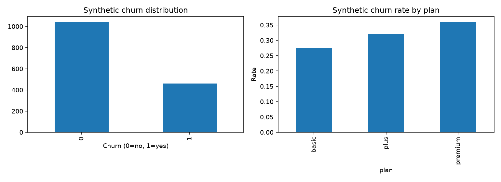

# Synthetic Customer Churn Prediction | Predicción de abandono de clientes


**EN:** Reproducible end-to-end Data Science portfolio demonstration using a **fully synthetic** monthly-subscription dataset. Includes EDA, preprocessing, stratified train/test split, five-fold cross-validation, baseline comparison, evaluation, model interpretation, and GitHub Actions.

**ES:** Demostración reproducible de Ciencia de Datos con un dataset **completamente sintético** de suscripciones mensuales. Incluye análisis exploratorio, preparación de datos, separación estratificada, validación cruzada, comparación con modelo base, métricas, interpretación y pruebas automatizadas.

## Problem / Problema

**EN:** Can behavior-like synthetic signals estimate which fictional subscribers might cancel their subscription? This is a teaching problem, not a validated customer-retention system.

**ES:** ¿Pueden variables ficticias de actividad estimar qué suscriptores simulados abandonarían un servicio? Es un ejercicio educativo, no un sistema de retención validado en producción.

## Stack
Python 3.10+, pandas, NumPy, scikit-learn, Matplotlib, pytest, Ruff, GitHub Actions.

## Workflow / Flujo
`Synthetic generator -> CSV -> EDA -> stratified split -> leakage-safe preprocessing -> training CV -> frozen model selection -> holdout evaluation -> interpretation + reports`

See [methodology](docs/methodology.md) for assumptions and limitations.

## Quick start / Instalación y ejecución

```bash
python -m venv .venv
# Windows PowerShell: .\.venv\Scripts\Activate.ps1
# Linux/macOS: source .venv/bin/activate
python -m pip install -e ".[dev]"
python -m churn_ml all
python -m pytest -q
python -m ruff check src tests
```

For Windows without activation, replace `python` with `.\.venv\Scripts\python.exe`.

Other CLI commands:

```bash
python -m churn_ml generate --rows 1500 --seed 42
python -m churn_ml analyze
python -m churn_ml train
```

## Dataset / Datos sintéticos

**EN:** `data/synthetic_subscriptions.csv` is generated from scratch with fixed seed 42. All relationships, churn labels, categorical groups, numeric ranges and identifiers are invented. Never infer operational statistics or real customer behavior from these records.

**ES:** `data/synthetic_subscriptions.csv` se genera desde cero con semilla 42. Todas las relaciones, etiquetas, categorías, valores e identificadores son ficticios. No deben interpretarse como estadísticas de ninguna empresa.

Inputs: `tenure_months`, `monthly_fee`, `support_tickets_90d`, `logins_30d`, `payment_failures_90d`, `plan`, `auto_renew`. The invented `customer_id` is never fed to the model. Target: `churn` (0/1).

## Analysis / Análisis



Generated outputs:

- `artifacts/eda.png`: exploratory plots.
- `artifacts/eda_summary.csv`: descriptive statistics.
- `artifacts/metrics.json`: actual CV and holdout evaluation metrics.
- `artifacts/test_predictions.csv`: holdout predictions; no real customer records.
- `artifacts/model.joblib`: local fitted model artifact, **excluded from repository package**; load only if generated by you.

The test dataset stays untouched during selection. Compare cross-validated ROC-AUC for logistic regression versus a constant-prior baseline. Report test ROC-AUC, average precision, F1, precision, recall, Brier score and the confusion matrix. Threshold is predetermined at 0.5. Permutation importance measures sensitivity to feature shuffling, **not causality**.

## Results / Resultados

See [measured metrics](artifacts/metrics.json) and the [bilingual interpretation](docs/results_interpretation.md). On the 300-row synthetic holdout, ROC-AUC was **0.723** and recall was **0.239** at the fixed 0.5 threshold. These numbers reflect only this synthetic demonstration and are not production claims.

## Tests / Pruebas

```bash
python -m pytest -q
python -m ruff check src tests
```

Tests cover dataset reproducibility, schema validation, invalid targets and a complete train-to-export cycle. CI runs Python 3.10 and 3.13.

## Design choices / Decisiones técnicas

- Pipelines learn preprocessing only on training folds to avoid leakage.
- A fixed holdout prevents overfitting the evaluation to model selection.
- An explicit baseline avoids presenting a model without comparison.
- A deterministic generator supports independent reproduction.
- No APIs, company data, credentials, cloud resources or sensitive identifiers.

## Next steps / Mejoras futuras

Add model calibration plots, confidence intervals, nested CV for hyperparameter selection, drift monitoring, and subgroup diagnostics **only when meaningful, properly sourced datasets are available**.

## Skills demonstrated / Habilidades demostradas

Python, exploratory data analysis, feature engineering, preprocessing pipelines, classification, cross-validation, ROC-AUC, precision-recall metrics, model interpretation, reproducibility and CI.

## Portfolio Demonstration Notice / Aviso de portafolio

**EN:** This repository is independently developed for portfolio purposes using an entirely fictional problem and synthetic data. It contains no employer source code or confidential information and is not affiliated with or endorsed by an employer.

**ES:** Este repositorio se desarrolló de manera independiente con fines de portafolio, usando un problema ficticio y datos sintéticos. No contiene código corporativo ni información confidencial y no está afiliado ni respaldado por ningún empleador.

## Rights / Derechos

No open-source license has been granted by default. Review publishing and licensing rights before adding a license.
